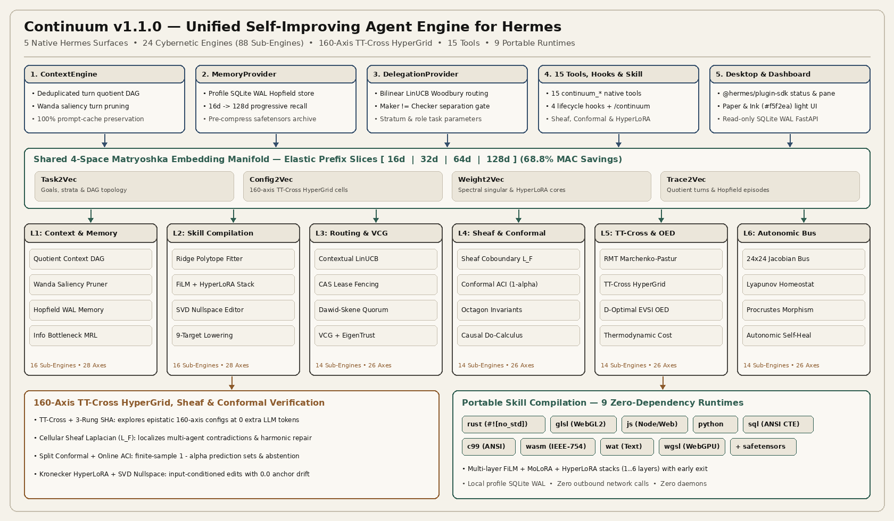

# Continuum — Unified Self-Improving Agent Engine (`v1.1.0`)

**Smart context compression, local episodic memory, Cellular Sheaf & Conformal verification, 160-axis TT-Cross configuration tuning, and 9-target skill compilation for Hermes Agent (`>=0.23.0`).**



**Continuum** gives Hermes Agent a unified, self-improving runtime that gets faster, sharper, and more reliable as you work. Instead of bolting together disconnected utilities, Continuum connects **five native Hermes extension surfaces** over one shared local engine: **24 cooperating cybernetic engines** (`88` sub-engines across `6` functional layers), **shared 4-space Matryoshka embeddings** (`16d / 32d / 64d / 128d`), a **160-axis `TT-Cross` adaptive configuration grid** that tunes itself offline using **zero extra LLM tokens**, and a **portable skill compiler** targeting nine zero-dependency runtimes.

Everything runs **100% locally in-process** backed by profile-scoped SQLite WAL storage and dual-mode linear algebra (pure Python standard library out of the box, with automatic NumPy acceleration when installed). Continuum makes **zero outbound network calls**, spawns **zero background TCP daemons**, requires **zero API keys**, and commits **zero binary blobs** to source control.

---

## Five Native Hermes Surfaces in One Plugin

| Surface | Registration API | What It Does for Hermes |
| :--- | :--- | :--- |
| **1. `ContextEngine`** | `ctx.register_context_engine` | Deduplicates repeated turns in a content-addressed quotient DAG, prunes low-saliency filler when approaching context limits, preserves the exact `request_messages` list reference when within budget for 100% prompt-cache hits, supports thread-safe `clone_for_agent()`, and provides `continuum_context_grep`. |
| **2. `MemoryProvider`** | `ctx.register_memory_provider` | Stores session memories in a profile-isolated SQLite WAL store (`HERMES_HOME/plugin-data/continuum/continuum.db`), retrieves relevant context via fast coarse-to-fine (`16d -> 32d -> 64d -> 128d`) search, suppresses writes during `cron` / `subagent` / `flush` runs, and consolidates pre-compaction turns into portable `.safetensors` micro-cartridges. |
| **3. `DelegationProvider`** | `ctx.register_delegation_provider` | Extends subtask routing with `engine_stratum`, `verification_role` (`maker` / `checker`), and `maker_id`; routes subtasks using online contextual LinUCB Woodbury scoring and enforces strict `maker != checker` separation (`DelegationRouteError` on collision). |
| **4. Tools, Hooks, Command & Skill** | `register_tool` / `register_hook` / `register_command` / `register_skill` | Registers **15 `continuum_*` agent tools**, **4 session lifecycle hooks** (`on_session_start`, `pre_tool_call`, `post_tool_call`, `on_session_end`), the `/continuum [status\|step]` slash command, and the bundled `continuum` workflow skill. |
| **5. Desktop & Web Dashboard** | `desktop/plugin.js` + `dashboard/` | Native Hermes Desktop status-bar chip, inspector pane, and settings page built exclusively on `@hermes/plugin-sdk` + `react/jsx-runtime` (`#f5f2ea` Paper & `#141413` Ink light palette), paired with read-only SQLite WAL FastAPI telemetry endpoints (`/status`, `/engines`). |

---

## What's New in `v1.1.0`

1. **24 Cybernetic Engines (`88` Sub-Engines across `6` Layers)**: expands the architecture with `SheafConsensusTopologyEngine`, `ConformalCalibrationEngine`, `CausalCounterfactualEngine`, `GameTheoreticMechanismEngine`, `FormalInvariantSynthesisEngine`, `ActiveExperimentalDesignEngine`, `InformationBottleneckCompressionEngine`, and `AutonomicSelfHealingEngine`.
2. **160-Axis `TT-Cross` Epistatic `HyperGrid`**: pairs low-rank Tensor-Train Cross (`TensorTrainCross`) fiber sweeps with strength-2 pairwise covering arrays, Sobol quasi-random probes, and 3-rung Successive Halving (`16d -> 64d -> 128d`) to discover non-additive cross-parameter optima in $\mathcal{O}(d r^2 L)$ evaluations at **`0` extra LLM tokens**.
3. **Cellular Sheaf Consistency Auditing (`continuum_sheaf_consistency_audit`)**: builds a Cellular Sheaf coboundary operator $\delta$ and Sheaf Laplacian $L_{\mathcal{F}} = \delta^\top \delta$ across multi-agent claims and restriction maps, localizes contradictory edges via local frustration energy $\|\mathcal{F}_{v \trianglelefteq e} x_v - \mathcal{F}_{u \trianglelefteq e} x_u\|_2^2$, and computes Tikhonov harmonic consensus repairs $(I + \eta L_{\mathcal{F}})^{-1} x$.
4. **Distribution-Free Conformal Calibration (`continuum_conformal_calibrate`)**: combines finite-sample Split Conformal quantiles ($\lceil (n+1)(1-\alpha_t) \rceil$) with Gibbs-Candès Online Adaptive Conformal Inference (`ACI`, $\alpha_{t+1} = \alpha_t + \gamma(\alpha - \text{err}_t)$) to construct guaranteed `1 - alpha` prediction sets and route selectively between Layer-0 cartridges, multi-layer operator stacks, or full deliberation.
5. **Input-Conditioned Kronecker `HyperLoRA` (`continuum_hyperlora_modulate`)**: generates rank-$R$ Kronecker weight modulations $\Delta W(e(x)) = \sum_r \alpha_r (U_r(e(x)) \otimes V_r(e(x)))$ projected strictly onto the orthogonal complement of protected safety-anchor subspaces (`0.0` anchor drift) and exports directly to any portable runtime.
6. **9 Zero-Dependency Portable Cartridge Runtimes**: adds bare-metal `#![no_std]` **`rust`** (`pub unsafe extern "C" fn infer` with `[5/5]` Padé `tanh`, zero heap allocations) and **`glsl`** (`#version 300 es` WebGL2 fragment compute shader) alongside **`js`**, **`python`**, **`sql`**, **`c99`**, **`wasm`**, **`wat`**, and **`wgsl`** (plus `.safetensors` buffers).

---

## Portable Skill Compilation Across 9 Standalone Runtimes

`continuum_compile_cartridge` and `continuum_hyperlora_modulate` lower multi-layer (`1..6` layers) `FiLM` + `MoLoRA` + `HyperLoRA` operator stacks into nine zero-dependency targets:

| Target | Output Artifact | Execution Environment |
| :--- | :--- | :--- |
| **`rust`** | `#![no_std]` zero-alloc module exporting `evaluate_cartridge` + C ABI `infer` | Embedded firmware, OS kernels, `cdylib` FFI |
| **`glsl`** | `#version 300 es` high-precision fragment compute shader | WebGL2 browsers & mobile GPUs |
| **`js`** | Zero-dependency ES/CommonJS module exporting `infer(xIn, zCond)` | Node.js, Cloudflare Workers, browsers |
| **`python`** | Standalone pure-stdlib Python module exporting `infer` | Any Python 3 runtime |
| **`sql`** | Pure ANSI SQL CTE matrix-vector query (`WITH cartridge_weights AS ...`) | SQLite, PostgreSQL, DuckDB |
| **`c99`** | Self-contained ANSI C99 source exporting `continuum_eval_stack` & `infer` | Native C/C++ binaries & microcontrollers |
| **`wasm`** | IEEE-754 WebAssembly 1.0 binary synthesized dynamically in memory (base64) | Wasmtime, V8, browser `WebAssembly.instantiate` |
| **`wat`** | Human-auditable WebAssembly Text S-expression module | WebAssembly toolchains & security review |
| **`wgsl`** | `@compute @workgroup_size(16)` storage-buffer compute kernel | WebGPU native & browser compute pipelines |

*(Auxiliary interchange format `safetensors` is also supported for IEEE-754 `float32` tensor serialization with embedded `Weight2Vec` headers.)*

---

## The 24 Cooperating Cybernetic Engines (`88` Sub-Engines)

| # | Engine ID | Functional Layer | Adaptation Cadence | Sub-Engines |
| :--- | :--- | :--- | :--- | :---: |
| 0 | `quotient_context_dag_engine` | Context & Memory | Fast turn reflex | 4 |
| 1 | `wanda_saliency_pruning_engine` | Context & Memory | Fast turn reflex | 4 |
| 2 | `hopfield_attractor_memory_engine` | Context & Memory | Session consolidation | 4 |
| 3 | `information_bottleneck_compression_engine` | Context & Memory | Fast turn reflex | 4 |
| 4 | `ridge_polytope_compiler_engine` | Skill Compilation | Session consolidation | 4 |
| 5 | `multilayer_film_molora_stack_engine` | Skill Compilation | Task episode | 4 |
| 6 | `svd_nullspace_surgical_editor_engine` | Skill Compilation | Task episode | 4 |
| 7 | `portable_target_lowering_engine` | Skill Compilation | Session consolidation | 4 |
| 8 | `contextual_linucb_router_engine` | Routing & Mechanism | Task episode | 4 |
| 9 | `cas_fission_lease_fencing_engine` | Routing & Mechanism | Fast turn reflex | 3 |
| 10 | `dawid_skene_quorum_adjudicator_engine` | Routing & Mechanism | Task episode | 3 |
| 11 | `game_theoretic_mechanism_engine` | Routing & Mechanism | Session consolidation | 4 |
| 12 | `sheaf_consensus_topology_engine` | Sheaf & Conformal | Task episode | 4 |
| 13 | `conformal_calibration_engine` | Sheaf & Conformal | Fast turn reflex | 4 |
| 14 | `formal_invariant_synthesis_engine` | Sheaf & Conformal | Session consolidation | 3 |
| 15 | `causal_counterfactual_engine` | Sheaf & Conformal | Task episode | 3 |
| 16 | `rmt_marchenko_pastur_spectral_engine` | TT-Cross & OED | Session consolidation | 4 |
| 17 | `fluid_hypergrid_interpolator_engine` | TT-Cross & OED | Fast turn reflex | 4 |
| 18 | `active_experimental_design_engine` | TT-Cross & OED | Fast turn reflex | 3 |
| 19 | `operation_cost_thermodynamic_engine` | TT-Cross & OED | Task episode | 3 |
| 20 | `inter_engine_coupling_and_jacobian_bus` | Autonomic Coupling | Cross-task transfer | 4 |
| 21 | `homeostatic_meta_controller_engine` | Autonomic Coupling | Grid range evolution | 3 |
| 22 | `structural_morphism_and_transfer_engine` | Autonomic Coupling | Cross-task transfer | 3 |
| 23 | `autonomic_self_healing_engine` | Autonomic Coupling | Task episode | 4 |

---

## Agent Tool Suite (15 Tools)

1. `continuum_fission_dag` — Split complex goals into a deduplicated subtask graph with clear interface contracts and minimal clarifying questions.
2. `continuum_claim_and_fence` — Claim a subtask with an atomic SQLite lease stamp or return an instant verified cache hit.
3. `continuum_verify_record` — Record independent `maker != checker` verification and update LinUCB, Dawid-Skene, and EigenTrust weights.
4. `continuum_compile_cartridge` — Compile rules or verified examples into a multi-layer skill cartridge across any of the 9 portable runtimes (`rust`, `glsl`, `js`, `python`, `sql`, `c99`, `wasm`, `wat`, `wgsl`, plus `safetensors`).
5. `continuum_analyze_spectrum` — Inspect Marchenko-Pastur noise floors, Roy-Vetterli effective rank, power-law $\alpha$, and Wanda input saliency.
6. `continuum_surgical_edit` — Apply targeted weight updates with CEGAR counterexample healing and `0.0` anchor drift.
7. `continuum_coupling_step` — Propagate Lyapunov-damped `24x24` Jacobian impulses and run zero-token `TT-Cross` + SHA offline config tuning.
8. `continuum_morphism_transfer` — Detect structurally matching task graphs via Laplacian spectra and transplant skills via Orthogonal Procrustes.
9. `continuum_calibrate_effort` — Compute Expected Value of Sample Information (`EVSI`) to pick reasoning effort, embedding slice width, and escalation thresholds.
10. `continuum_manifold_status` — Inspect live status across all 24 engines, 88 sub-engines, 160-axis parameter ledger counts, and compute savings.
11. `continuum_context_grep` — Search compressed and active session turns using hybrid keyword + nested vector matching.
12. `continuum_attractor_recall` — Retrieve relevant episodic memories from the local SQLite WAL Hopfield store.
13. `continuum_sheaf_consistency_audit` — Build a Cellular Sheaf Laplacian across multi-agent claims to localize contradictions and compute harmonic consensus.
14. `continuum_conformal_calibrate` — Construct Split Conformal + Online ACI `1 - alpha` prediction sets with selective abstention routing.
15. `continuum_hyperlora_modulate` — Generate input-conditioned Kronecker `HyperLoRA` weight modulations in the safety-anchor nullspace (`0.0` drift) across any of the 9 portable targets.

---

## Measured Local Benchmarks

Measured on Linux x86_64 across both **NumPy-accelerated** and **pure Python standard-library** (`python_dependencies: []`) runtimes:

| Operation | Latency (NumPy) | Key Mathematical Guarantee |
| :--- | :---: | :--- |
| **Initialize 24 Engines + 160-Axis `TT-Cross` Grid** | `~75 ms` | 72 verified baseline config cells indexed at startup |
| **Progressive `16d->32d->64d->128d` Recall (128 items)** | `~2.0 ms` | **`68.8%` MAC reduction** vs. exhaustive `128d` scan |
| **`TT-Cross` + 3-Rung SHA Config Tournament** | `~92 ms` | **`0` extra LLM tokens** (replays verified local history) |
| **Cellular Sheaf Audit + Harmonic Consensus Repair** | `~0.9 ms` | Exact localization of contradictory edges + obstruction decay |
| **Kronecker `HyperLoRA` + Surgical Edits (All 24 Engines)** | `~3.4 ms` | **`0.0` anchor drift** (`< 1e-15` numerical residual) |
| **Cross-Runtime Compilation (`rust`, `c99`, `wasm`, `js`, `sql`, `python`)** | `< 4 ms` emit | **`< 1e-5` numerical parity** across native `rustc`, `gcc`, `node`, & SQLite |

---

## Installation & Configuration

Install via the Hermes plugin CLI:

```text
hermes plugins install continuum
```

Optional provider activation keys in your Hermes profile settings:
- Context Engine: `context.engine: continuum`
- Memory Provider: `memory.provider: continuum`
- Delegation Provider: `delegation.provider: continuum`

Plugin configuration options (`config_schema`):
- `compute_headroom_ratio` (`float`, default `0.6`): fraction of spare local CPU budget used to test `TT-Cross` and Sobol candidate configurations against saved history using zero extra LLM tokens.
- `default_embedding_dim` (`int`, default `64`): default nested embedding slice width (`16`, `32`, `64`, or `128`) for fast retrieval and routing.
- `enable_idle_exploration` (`bool`, default `true`): automatically evaluate and promote better verified configurations at session end.

---

## Security, Privacy & Isolation

- **Zero Network Egress**: Continuum performs zero HTTP, WebSocket, DNS, or raw socket calls.
- **Zero Background Daemons**: all logic runs synchronously in-process; dashboard endpoints read SQLite WAL state in read-only mode (`mode=ro`).
- **Zero External Secrets**: requires zero API keys (`requires_env: []`) and never reads environment variables directly for credentials.
- **Zero Binary Blobs in Git**: WebAssembly binaries (`wasm`) and `.safetensors` buffers are generated deterministically in memory when requested.
- **Whitelisted Public API Only**: imports exclusively documented Hermes v0.23.0+ extension interfaces (`agent.context_engine`, `agent.memory_provider`, `agent.delegation_provider`, `hermes_constants`, `plugins.plugin_storage`) with clean standalone fallbacks.

## License

MIT License — Copyright (c) 2026 `aidonerightcorp`.
