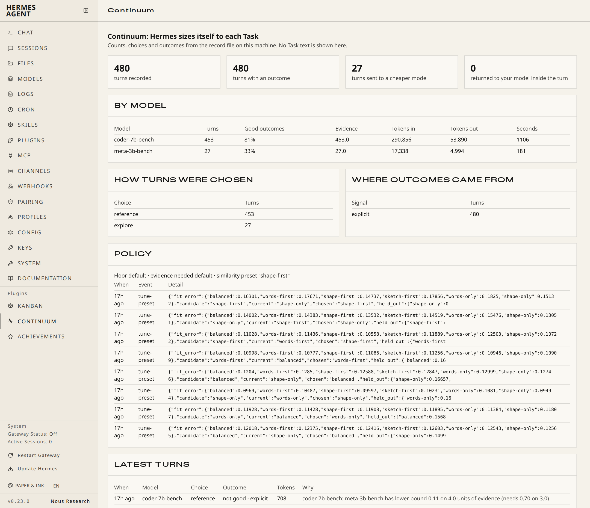

# Continuum

**Hermes sizes itself to each Task.**

Most turns do not need your largest model. Continuum learns, from your own sessions, which kinds of Task a cheaper
model answers just as well, and sends only those Tasks there. Everything else stays on your own model. It records every
model attempt, checks its own choices against records it kept aside, and becomes more careful by itself when the
cheaper model starts to fall behind.

It is a Hermes plugin for Hermes Agent `>=0.23.0`. Pure Python, no dependencies, no network calls of its own.


## What happens in one turn

1. **Fingerprint.** Your message becomes a Task fingerprint with six scored levels, from exact match to continuous
   similarity: exact text, template (the text with its numbers and links masked), contract (what kind of answer is
   wanted), a MinHash sketch, word overlap, and a 16-number shape profile. An LSH band match is also computed and
   shown by `/continuum why`; it is not part of the score.
2. **Find similar Tasks.** Continuum looks up the most similar Tasks in its record file on your machine and reads how
   each of your models did on them.
3. **Choose.** If the records support it (a lower bound on the pass rate, not the average), the turn goes to the
   cheapest model that should still pass. With too little evidence the turn stays on your own model, except for a
   small trial share (10 % by default) that starts once you have marked one of your recent turns.
4. **Protect the turn.** If a call to the cheaper model fails and Hermes tries the request again, or if the turn
   needs too many calls, Continuum returns the same turn to your own model. It does the same when the request grows
   too long for the cheaper model, if you gave its context window (`small_model_max_context`). One case ends the
   turn: when the provider refuses the request for the cheaper model and Hermes does not try again, Hermes shows the
   provider's error for that turn, and Continuum keeps the session on your own model. A model that the provider
   does not know or does not let you use is blocked at once; any other refusal blocks it after three in a row.
   Faults of your account or of the request itself (login, billing, content policy) never block a model.
   `/continuum` shows a block and its reason.
5. **Record and learn.** Every model call, tool call and outcome is stored. `/continuum good|bad` is the outcome
   that teaches most; your next message, a thank-you or a correction also count. On a share of the turns a cheaper
   model answered, your own model is asked one PASS or FAIL question: a FAIL counts against the cheaper model, a PASS
   counts only a little. An empty or cut-off answer from a cheaper model counts against it.

Ask `/continuum why` after any turn to see the fingerprint, the similar Tasks, the choice and the result:

```text
Continuum · turn 20261110_162617_40a748:1
Task     in:text|out:choice · 41 words · template 86a272e9 · fit split
Levels   nearest record 1.00: exact 0 · template 0 · contract 1 · LSH band 1 · sketch 0.66 · words 0.84 · profile 1.00
Choice   coder-7b-bench [reference] coder-7b-bench: meta-3b-bench has lower bound 0.23 on 8.3 units of evidence (needs 0.70 on 3.0)
Result   1 model calls (0 failed) · 616 in / 153 out tokens · 0 tool calls · 2.8 s
Outcome  pass from 'explicit' with weight 1.0
```

## Why this is a plugin, not a prompt or a skill

A prompt cannot choose the model that reads it. Continuum works on the parts of Hermes that only a plugin reaches:

| Hermes surface | What Continuum does with it |
| :--- | :--- |
| `llm_request` middleware | Sets the model, the request settings and the tool list of the provider request |
| `pre_llm_call` hook | One fingerprint and one choice for each turn; may add your own recorded answer to a near-identical Task |
| `post_api_request`, `api_request_error` hooks | Record every model call, failures included; return a failed turn to your own model; block a model that the provider refuses |
| `post_tool_call` hook | Records which tools a Task really used |
| `post_llm_call` hook + `ctx.side_question` | Stores the result and asks your own model one PASS or FAIL question on a sample |
| `on_session_end`, `on_session_finalize` hooks | Audit the policy on held-out records; close open outcomes; tune similarity weights |
| Tool `continuum_recall` | Lets the agent look up how similar Tasks of the same user were answered before |
| Command `/continuum` | Status, the reason for the last choice, outcome marks, pin, unblock, audit, tune, forget-text, compact, export, import |
| Dashboard tab and desktop pane | A read-only view of choices and outcomes |
| Bundled skill `continuum` | Teaches the agent to read the records and to use recall |

## Quick start

```text
hermes plugins install continuum                    # from the Hermes plugin catalog
hermes plugins install aidonerightcorp/continuum    # or from Git, before the catalog entry is merged
hermes plugins enable continuum
```

`enable` asks for two permissions. Both are optional, and Continuum works at a lower level without them:

| Permission | With it | Without it |
| :--- | :--- | :--- |
| `llm.model_override` | Continuum may change your provider request: send a turn to your cheaper model, add your own recorded answer to a near-identical Task, and (with `size_tools: on`) shorten the tool list. Spend follows the chosen model. | Observe mode: it records, and reports what it would have chosen. No request is changed, and the recall tool shows no records. |
| `llm.side_question` | On a share of turns, your own model answers one PASS or FAIL question about the answer. This spends your own model's tokens. | No checks. Continuum learns from your marks and from weaker signals only. |

Then name a cheaper model on the same provider as your own model, in `config.yaml`:

```yaml
plugins:
  entries:
    continuum:
      settings:
        small_model: "<id of a cheaper model on your provider>"
```

Use Hermes as usual and mark answers with `/continuum good` or `/continuum bad` now and then. Continuum starts on
your own model for everything. Once you have marked a recent turn, it tries the cheaper model on a small share of
turns (`explore_share`), and it moves a kind of Task over only when marks on similar Tasks support it (on a shared
gateway, the marks of anyone on it). With no marks it makes no trial turns and moves nothing; it records, and
`/continuum why` shows what it would do.

Continuum uses the cheaper model only on the provider and address where it first used it. A turn that runs on
another provider (a fallback, or a provider you changed to) is left alone. After you change provider for good, run
`/continuum unblock` once.

## Measured results

Two two-phase benchmarks (`tests/benchmark/everyday-v1/RESULTS.md` and `tests/benchmark/two-phase-v1/RESULTS.md`) run
Hermes's own `AIAgent` loop in-process, one new session per Task, no tools, on two open-weight 4-bit models on one
local 12 GB card (`coder-7b-bench` as the user's own model and `meta-3b-bench` as the cheaper model, 16,384-token
window, temperature `0.2`). In each run Continuum starts with an empty record file on 240 learning Tasks and is then
measured on 240 held-out test Tasks.

In **`everyday-v1`** (480 Tasks of eight everyday kinds: category choice, date choice, largest number, sum of two,
tracking choice, unit conversion, multi-step word problems, and one-step word problems), on the 240 held-out test Tasks:

| Arm | Right (95 % interval) | Difference vs own model | Answered by small model | Model seconds | Tokens on own model | Tokens on small model |
| :--- | :--- | :--- | :--- | :--- | :--- | :--- |
| `A-own-model` (`coder-7b-bench`) | 80.0 % (74.6 % to 85.0 %) | baseline | 0.0 % | 538 s | 182,189 | 0 |
| `B-small-model` (`meta-3b-bench`) | 48.3 % (42.1 % to 54.6 %) | -31.7 pts (-39.2 to -24.2) | 100.0 % | 812 s | 0 | 191,442 |
| `C-marked` (Continuum, marked) | 77.5 % (72.1 % to 82.9 %) | -2.5 pts (-8.3 to +3.8) | 2.5 % | 566 s | 178,439 | 6,413 |
| `D-self-checked` (Continuum, self-checked) | 59.2 % (52.9 % to 65.4 %) | -20.8 pts (-28.3 to -13.8) | 75.4 % | 1,130 s | 215,124 | 143,523 |
| `E-marked-fast` (`explore_share: 0.3`) | 73.8 % (68.3 % to 79.2 %) | -6.2 pts (-12.1 to -0.4) | 1.2 % | 500 s | 179,854 | 2,501 |

In **`two-phase-v1`** (480 harder reasoning Tasks of six kinds: arithmetic expressions, date choice, object counting,
tracking choice, one-step and multi-step word problems), on the 240 held-out test Tasks:

| Arm | Right (95 % interval) | Difference vs own model | Answered by small model | Model seconds | Tokens on own model | Tokens on small model |
| :--- | :--- | :--- | :--- | :--- | :--- | :--- |
| `A-own-model` (`coder-7b-bench`) | 61.3 % (55.0 % to 67.5 %) | baseline | 0.0 % | 628 s | 190,280 | 0 |
| `B-small-model` (`meta-3b-bench`) | 27.5 % (22.1 % to 33.3 %) | -33.8 pts (-41.2 to -25.8) | 100.0 % | 1,195 s | 0 | 209,736 |
| `C-marked` (Continuum, marked) | 55.4 % (49.2 % to 61.7 %) | -5.8 pts (-13.3 to +1.7) | 2.1 % | 605 s | 185,713 | 4,596 |
| `D-self-checked` (Continuum, self-checked) | 47.1 % (40.8 % to 53.8 %) | -14.2 pts (-21.7 to -6.7) | 42.1 % | 797 s | 207,903 | 83,474 |
| `E-marked-fast` (`explore_share: 0.3`) | 60.4 % (54.6 % to 66.7 %) | -0.8 pts (-7.5 to +5.8) | 1.7 % | 591 s | 185,841 | 3,435 |

**Arm D, and the rule that came from it.** Both D arms ran the plugin as frozen at 14:40 on November 10, when a PASS
from your own model's check counted as strong evidence. Across the two runs that check passed 224 of 270 wrong
answers (and failed 5 of 208 right ones), so the 3B model answered 75 % and 42 % of the test Tasks.
Since then a PASS (and a thank-you) counts as weak evidence, a cheaper model takes over only on strong outcomes such
as marks, and trial turns wait until you have marked one of your recent turns. A replay of the same recorded answers
through the changed engine (no new model calls; six Task orders) moves no Task when nobody marks and matches the own
model (80.0 % and 61.3 % on the two test phases); the same replay of the earlier engine, with the check drawn at the
measured rates, lost 12.5 and 8.3 points. A replay is not a live run. The replay tool is
`tests/benchmark/policy_lab.py`; its outputs and a guide are in `tests/benchmark/lab/`.

**The changed plugin, live, on 480 new Tasks** (`tests/benchmark/everyday-v2/`; the same eight kinds, Tasks that no
earlier run or replay read; plugin copy frozen at 22:19 on November 10, see `RUN-NOTES.md` there for the later review
fixes, which do not change these sessions). Test phase, 240 Tasks:

| Arm | Right (95 % interval) | Difference vs own model | Answered by small model |
| :--- | :--- | :--- | :--- |
| `A-own-model` | 80.4 % (75.4 % to 85.0 %) | baseline | 0.0 % |
| `A2-own-model-repeat` (the same model again) | 80.4 % (75.0 % to 85.0 %) | +0.0 pts (-5.8 to +5.8) | 0.0 % |
| `B-small-model` | 47.5 % (41.2 % to 53.8 %) | -32.9 pts (-40.0 to -26.2) | 100.0 % |
| `C-marked` (Continuum, every answer marked) | 78.3 % (72.9 % to 83.3 %) | -2.1 pts (-7.9 to +4.2) | 4.2 % |
| `D-self-checked` (Continuum, nobody marks, own model checks) | 78.8 % (73.3 % to 83.8 %) | -1.7 pts (-7.1 to +3.3) | 0.0 % |

With nobody marking, the changed plugin kept every Task on your own model; before the change the same arm lost 20.8
points on the everyday-v1 Tasks (table above). Two passes of the same model scored the same in the test phase but gave
a different right-or-wrong result on 102 of the 480 Tasks (`RUN-NOTES.md`), so a gap of a few points between single
runs is noise. On this card the 3B model is weak on seven of the eight kinds, so with marks Continuum kept 96 % of
the test Tasks on your own model, with 95 % of its tokens (96 % of its price at an assumed 0.2 price ratio) and 103 %
of its model seconds; no run here has yet shown a clear saving.

Full per-kind tables and limits are in `tests/benchmark/everyday-v1/RESULTS.md` and
`tests/benchmark/two-phase-v1/RESULTS.md`.

## How it learns without fooling itself

- **Strong and weak outcomes are kept apart.** Strong outcomes are a mark from you (weight 1.0), a FAIL from your
  own model's check (0.8), and clear signs of a failure in the session (0.5 to 0.7): a correction or the same
  question again in your next message, a turn that had to return to your own model, and a failed, empty or cut-off
  answer. Weak ones (0.2 to 0.3) are a PASS from your own model's check, a thank-you, "the user moved on" and "the
  session ended" on the good side, and on the bad side a turn where half of the tool calls failed and a provider fault that passes
  by itself (rate limit, overload, timeout). Once strong outcomes near a Task reach one unit of evidence, Continuum reads those alone.
  Turns of your own model with only weak outcomes are never counted as proof that your own model is better.
- **A held-out split.** One Task template in five is kept out of the choice. The audit uses these records to test the
  policy on Tasks the chooser did not learn from.
- **The audit can tighten and relax.** When cheaper-model turns pass less often than the target, Continuum raises its
  own floor and asks for more evidence. When they hold up, it relaxes again. It takes one step at a time, and the
  next step only after new outcomes have come in. Each change is written to the policy log. The audit reads your own
  records only, never imported ones.
- **A PASS from your own model is not proof.** In our two benchmark runs, the check by a 7B model passed 224 of 270
  wrong answers and failed only 5 of 208 right ones (the counts are in both RESULTS.md files). Counted as strong evidence, those PASSes
  moved most Tasks to the cheaper model and cost 20.8 and 14.2 points (the two `D-self-checked` arms). So a PASS is
  weak evidence, a FAIL counts in full, and a cheaper model takes over only on strong outcomes (`require_checked`).
  A thank-you counts as weak for the same reason: nobody has measured that people thank only right answers.
- **A lower bound, not an average.** A cheaper model takes a Task only when three things hold on similar Tasks: at
  least 3 units of strong evidence (similarity times outcome weight), a lower bound of its pass rate at or above the
  floor (0.70 at the start), and a pass rate not more than 0.05 behind your own model's where both have strong
  outcomes.
- **Evidence does not travel.** Records count only for Tasks that are similar enough. Passing arithmetic says nothing
  about a code review.
- **Bounded trials, only when they can teach.** Trial turns are a fixed small share, and they start only after you
  have marked one of your last 50 scored turns (`explore_needs_marks`; on a shared gateway, each sender's own marks).
  Without marks a trial turn would cost accuracy and could not move a Task on its own. Where a cheaper model already
  qualifies, a small share of turns stays on your own model and is checked in the same way, so the comparison stays
  fair.
- **You stay in control.** `/continuum pin` keeps a session on your own model, with no change to its requests, until
  `/continuum unpin`. The setting `mode: observe` records and changes no request. `mode: off` records nothing and
  changes nothing (a record file it cannot read is left as it is); a value that is not `auto` or `observe` is read
  as off. A pattern list (`never_downsize`) keeps
  named kinds of Task (payments, deploys, passwords, medical and legal text and others) on your own model always.

## Commands

```text
/continuum            status of the right-sizing loop
/continuum why        how the last turn was fingerprinted, chosen and recorded
/continuum good|bad   record the outcome of the last turn (strongest signal)
/continuum pin|unpin  keep this session on your own model, or release it
/continuum unblock    let Continuum try a cheaper model again after the provider refused it
/continuum audit      check the policy on held-out records now
/continuum tune       tune the similarity weights on the records now
/continuum forget-text  remove all stored Task and answer text; fingerprints and outcomes stay
/continuum compact    rewrite the record file after text was removed, so that no old copy stays in it
/continuum export     write fingerprints and outcomes (no text) to the plugin data folder
/continuum import F   read an export file F from the plugin data folder's inbox/
/continuum lab        status of the experimental engines
```

`unblock`, `audit`, `tune`, `forget-text`, `compact`, `export` and `import` act on the whole record file. They run only for
the local user: on Hermes's local surfaces (the terminal chat, the TUI, the desktop app, an editor session over
ACP), or from the shell as `hermes continuum <command>` (for example `hermes continuum forget-text`). On a chat
platform such as a messaging gateway they answer with a note and change nothing, so one chat user cannot remove,
export or re-tune the records of all users. The `lab` commands follow the same rule. On a chat platform
`/continuum` shows the mode, the model names, the counts, the policy values and short notes: a `mode` value it could
not read, a missing consent, and that Continuum is off for this run or started a new record file, with the kind of
error and no file name. The provider's name, the reason of a block, the name of a record file that was set aside and
the note about a pending rewrite are shown to the local user only.

The shell form runs every command except `pin` and `unpin`, which belong to one session: `hermes continuum`,
`hermes continuum why`. From the shell, `why`, `good` and `bad` act on the newest turn in the record file.

In the Hermes web dashboard (`hermes dashboard`), the **Continuum** tab shows the same local counts, model breakdown,
held-out policy log and recent choices with no Task text:



## Settings

All under `plugins.entries.continuum.settings`. Every threshold of the chooser, the audit and the outcome weights is
in `config/rightsize.json`, not in code.

| Setting | Default | Meaning |
| :--- | :--- | :--- |
| `mode` | `auto` | `auto` chooses a model for each Task. `observe` records and reports only. `off` records nothing and changes nothing. Every other value is read as off. A change takes effect when Hermes starts again. |
| `small_model` | empty | A cheaper model on your provider. Empty: Continuum records only. |
| `small_model_cost_ratio` | `0.2` | Cost of `small_model` as a share of your own model, used for the saving estimate. |
| `small_model_max_context` | `0` | Context window of `small_model` in tokens. When set, a request that grows past 80 % of it returns to your own model. `0`: not set. |
| `rungs` | empty | A JSON list for more than one cheaper model, each with its cost, request settings and context limit. |
| `size_tools` | `observe` | `on` sends only the tools that similar good Tasks of your own used; when a reply says a tool was missing, all tools return on the next turn. `observe` only reports the saving. Needs `mode: auto` and `llm.model_override`. |
| `recall` | `true` | Add your own recorded answer to a near-identical good Task to the turn as context. Needs `mode: auto` and `llm.model_override`. |
| `store_text` | `true` | Keep Task text and answers in the local record file. `false` keeps fingerprints and outcomes only; recall is then off, also for text stored earlier. |
| `text_days` | `90` | Days after which stored Task and answer text is removed; fingerprints and outcomes stay. `0`: keep the text until `/continuum forget-text`. |
| `explore_share` | `0.1` | Share of turns used to try a cheaper model that has too little evidence yet, once you have marked one of your recent turns. Where a cheaper model already qualifies, half of this share stays on your own model for comparison. |
| `check_share` | `0.3` | Share of cheaper-model turns checked by your own model. A FAIL counts against the cheaper model; a PASS counts as weak evidence. The few turns kept on your own model for comparison are always checked. `0` turns all checks off. |
| `self_tune` | `true` | Let Continuum tighten or relax its floor and tune its similarity weights. `false`: `/continuum audit` only reports what the records advise. |
| `enable_lab_tools` | `false` | Turn on the experimental engines of version 1: their 18 tools for the model and the `/continuum lab` commands (see below). |

## Share what was learned, without sharing text

`/continuum export` writes fingerprints and outcomes only: no Task text, no answers, and not the two marks of the
exact text. Another Hermes profile can read the file with `/continuum import`. Imported records are labelled, carry
half weight, and are capped below the evidence a choice needs, so they can support your own records and never move
a Task to a cheaper model alone. They never shape the tool list, they never push your own records out, and they are
never recalled as answers. Continuum never sends this file anywhere; moving it is your action.

A fingerprint is not text, but it is not nothing: a person who guesses a short Task can test the guess against the
word and sketch levels. Share an export file with the same care as a list of topics you worked on.

## What it stores and what it touches

- **Network:** Continuum makes no network call of its own. With `llm.side_question` granted, Hermes sends the check
  question to your own model on your own provider.
- **Files:** it reads and writes only inside `HERMES_HOME/plugin-data/continuum/`. The record file is
  `rightsize.db` (SQLite). The experimental engines, when you turn them on, keep their own file `continuum.db` in
  the same folder. If Hermes gives the plugin no data folder, Continuum is off, stores nothing, and the
  experimental engines stay off too.
- **What is stored:** by default, the text of each message and reply. For every turn also: the fingerprint, the
  choice and its reason, the model names, token counts, call times, tool names, the outcome, the Hermes session id,
  the platform name (for example `cli`) and a short one-way mark of platform and sender. For every model call: Hermes's
  request id, the model name, token counts, the time it took and the finish reason. For a failed model call: the
  kind of the error (a class name), Hermes's reason word and the status code, never the provider's message text.
  For the cheaper model: the provider name and address where it was first used, so that a turn on another provider
  is left alone, with a short one-way mark of your rung settings (never the settings themselves). Of the address only the
  scheme, host and port are stored, with a short one-way mark of its path; a user name, password or query in the
  address is dropped. No API key and no request header is stored.
- **How long text is kept:** stored text is removed after 90 days (`text_days`): Continuum looks when Hermes starts,
  when a session ends and at most once an hour, in every mode. Set `store_text: false` to keep fingerprints and
  outcomes only (recall is then off). `/continuum forget-text` removes all text already stored and then rewrites
  the file, so that the old text is gone from the file too. If the file cannot be rewritten at that moment
  (another Hermes process holds it, or the disk has no room), the command says so, and `/continuum` shows a note
  to the local user until the rewrite is done. `hermes continuum compact` does the rewrite alone; a start of
  Hermes also does it, for a record file up to 32 MiB. A turn never starts the rewrite. If two Hermes processes
  share one record file, a write in one of them waits up to one second while the other holds the file. When the
  wait is too long, the turn goes on: the end of that turn is written at the next message of that session or at
  its end, with the outcome the turn itself showed (a failed call, a fall back to your own model, a cut-off
  reply and failed tool calls stay what they were). If Hermes stops before that, the turn is closed the next
  time that session gets a message or ends: a turn that fell back to your own model keeps that failure, a turn
  with no model call that worked counts as an empty reply, and every other such turn is closed with no outcome
  and counts neither for nor against a model.
- **What `forget-text` does not touch:** a file that Continuum set aside because it could not read it
  (`rightsize.unreadable-*.db`) and the file of the experimental engines (`continuum.db`). The command names such
  files when they are there; delete them yourself if you do not want them.
- **Off means off:** with `mode: off` nothing new is stored and no record file is made; a record file from before
  is opened only to remove text that is past its days. A yes or no setting typed as text (`"false"`, `"no"`,
  `"off"`) is read as no; a value Continuum cannot read turns that setting off.
- **Shared gateways:** a recorded answer is shown again only to the same sender on the same platform. On a chat
  platform, a message that comes with no sender id gets no recorded answer, and `/continuum why|good|bad|pin|unpin`
  do nothing when Hermes gives no session id. The commands that act on the whole record file run only for the
  local user (see Commands). The sender is stored as a short one-way mark, not as a name or id. The
  record file itself is one file: a person who can open the Hermes home can read it.
- **What it changes:** in `mode: auto` with `llm.model_override` granted, the model and request settings of your
  provider request, the tool list (with `size_tools: on`), and one added context block when a near-identical Task of
  yours has a good recorded answer. Without the grant, or in `observe` or `off`, it changes no request.
- **Processes:** no subprocess, no shell command, no background service. One short-lived thread carries the check
  question so that the turn does not wait for it.
- **Secrets and telemetry:** it reads no `.env` file, no credential store and no API key, and reports no usage
  anywhere.
- **Unattended turns:** Hermes gives no check token to cron jobs and delegated subagents, so those turns are never
  checked by your own model. No check question is sent in `observe` mode or without the `llm.model_override` grant.
- **A turn two models answered:** when a turn starts on the cheaper model and ends on your own model for a reason
  other than a failed attempt (a consent taken back, a fault inside Continuum), the turn is recorded as `mixed`
  and counts for and against neither model.
- **A damaged record file:** if the file is not a record file at all, Continuum keeps it under a new name with its
  side files, starts a new one and says so in `/continuum`. If the file cannot be opened (no access, or held by
  another program), Continuum leaves it as it is and stays off until Hermes starts again.
- **Two Hermes processes on one record file:** this works, with limits. Pins, blocks and the audit's steps are
  each read and written in one step, so the processes do not undo each other. If one process holds the file while
  the other is in a turn, that turn goes out unchanged on your own model, and a model call that could not be
  recorded is missing from the counts. One record file per Hermes home is the tested case.

## Limits

- When the provider refuses a request for the cheaper model and Hermes does not try again, that one turn ends with
  the provider's error (or with your Hermes fallback model, if you have set one). If the provider does not know the
  model or does not let you use it, Continuum blocks the model; run `/continuum unblock` after you fix the model
  name or access.
- A model switch inside a session loses the provider's prompt cache for that turn. On long sessions with cached
  context, weigh this against the saving; `/continuum pin` keeps a session on one model.
- With no recent marks from you, Continuum makes no trial turns. A kind of Task that marks already moved (yours, or
  on a shared gateway anyone's) can stay on the cheaper model, with a share of comparison turns on your own model;
  unmarked turns slowly push it back to your own model, because they fill the nearest records with weak outcomes.
- The check is your own model's opinion of the answer, not ground truth. On the 7B local model in `everyday-v1`, the
  check agreed with the answer key on 184 of 327 checked turns (56.3 %: 160 of 165 when the answer was right, and 24 of
  162 when the answer was wrong); a small reference model approves most plausible-looking wrong answers. That is
  why a PASS counts as weak evidence and only marks (on a shared gateway, anyone's) move a kind of Task to the
  cheaper model; strong failures move it back.
- No live arm ran the shipped defaults with both consents granted (`check_share: 0.3`, no marks): arm D checked every
  cheaper answer. The replay above covers `check_share: 0.3` too (before the change: -4.1 and -4.0 points; after it:
  no Task moved).
- The saving estimate in `/continuum` status uses your `small_model_cost_ratio` and counts only cheaper-model turns
  that you marked good (a failed or unchecked turn may have to be done again); it is an estimate, not a bill.
- A new kind of Task starts on your own model, except for the trial share once you mark. Continuum needs a few
  similar records with strong outcomes before it moves a kind of Task.

## Reproduce the benchmark

The harness in `tests/benchmark/` runs Hermes's own agent loop in-process, one new session per Task, with and
without Continuum, and counts model calls with Hermes's own hooks in every arm. See `tests/benchmark/README.md`.
The harness is test code that drives Hermes from outside; Hermes never loads it, and the plugin itself uses only
Hermes's public plugin surfaces.

## Experimental engines

Version 1 of this plugin shipped a set of experimental engines (context compression, local memory, configuration
search and others) with 18 tools. They are still in the package and are off by default. `enable_lab_tools: true`
shows the 18 tools to the model and turns on the `/continuum lab` commands, for the local user only and never in
`mode: off`. The dashboard has three read-only status routes for them. Nothing else of version 1 is connected to
Hermes: no context engine, no memory provider, no delegation provider. They are research code. This README makes
no measured claim for them.

## Tests

```text
python -m pytest -q
hermes plugins validate .
hermes plugins doctor .
```

## License

MIT License. Copyright (c) 2026 `aidonerightcorp`.
